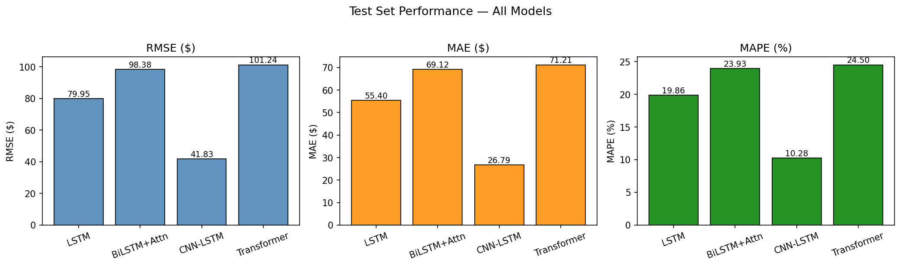
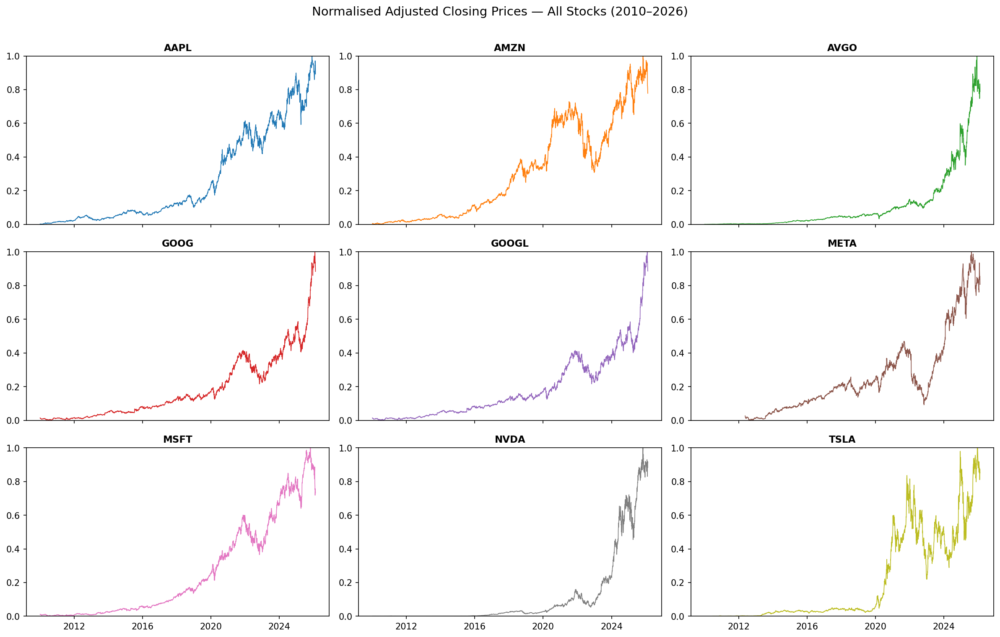
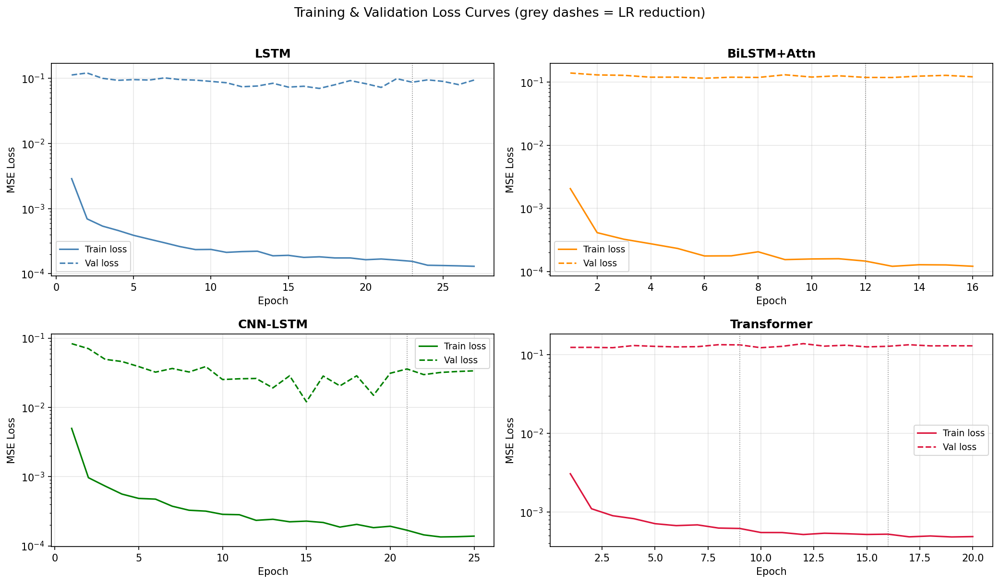
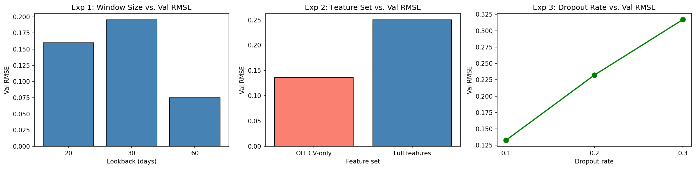
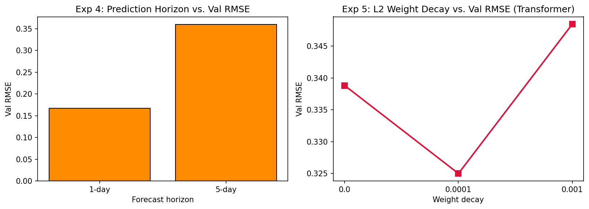
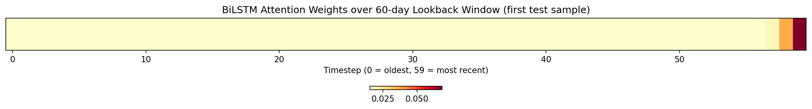
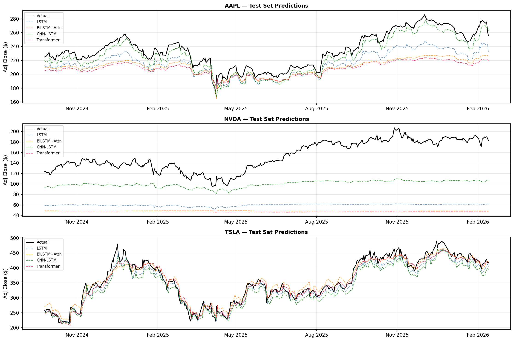
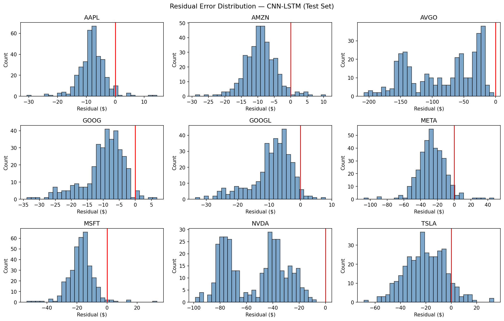

# S&P 500 Stock Price Forecasting with Deep Learning

One PyTorch model that forecasts the **next trading day's adjusted closing price** for nine S&P 500 tech stocks at once. Four architectures are built and compared (Stacked LSTM, BiLSTM with attention, CNN-LSTM, and a Transformer encoder written from scratch), and five controlled experiments probe what actually moves the error.

Course project for *COMS 4030A / COMS 7047A: Adaptive Computation and Machine Learning* (May 2026), built with Tazeem Tayob. The full write-up is in [ACML_Report_LaTeX.pdf](ACML_Report_LaTeX.pdf).

**Headline result:** the CNN-LSTM hybrid wins on every metric, with roughly half the error of the LSTM baseline.



| Model | RMSE ($) | MAE ($) | MAPE (%) | Directional accuracy (%) | Parameters |
|---|---:|---:|---:|---:|---:|
| Stacked LSTM (baseline) | 79.95 | 55.40 | 19.86 | 49.38 | 132,673 |
| BiLSTM + Bahdanau attention | 98.38 | 69.12 | 23.93 | 50.40 | 330,946 |
| **CNN-LSTM** | **41.83** | **26.79** | **10.28** | **51.17** | 51,169 |
| Transformer encoder | 101.24 | 71.21 | 24.50 | 50.46 | 76,865 |

All metrics are computed on the held-out test set (Jul 2024 to Feb 2026) after converting predictions back to real dollar prices.

## Data

[Kaggle: S&P 500 Top 10 Stocks OHLCV, 2010 to 2026](sp500_top10_stocks_clean.csv). 35,765 daily rows for AAPL, AMZN, AVGO, GOOG, GOOGL, META, MSFT, NVDA and TSLA, with no missing values.



| Split | Dates | Sequences | Used for |
|---|---|---:|---|
| Train | 2010-01-04 to 2022-12-31 | 27,746 | fitting the models |
| Validation | 2023-01-01 to 2024-06-30 | 2,826 | tuning and early stopping |
| Test | 2024-07-01 to 2026-02-13 | 3,132 | final evaluation only |

## Method

- **Features (28 per day):** OHLCV plus 17 technical indicators (SMA 5/20/50, EMA 12/26, MACD, RSI-14, Bollinger bands and bandwidth, 10-day volume average, daily return, 10-day volatility) and a one-hot ticker. Every indicator uses only past data, computed per stock, so there is no look-ahead and no cross-stock leakage.
- **Scaling:** one `MinMaxScaler` per stock, fitted on the training slice only and reused for validation and test.
- **Input / target:** the previous 60 trading days (about three months) predict the next day's adjusted close. Sequences from all nine stocks go into one shared dataset.
- **Training:** Adam (lr 1e-3), MSE loss, gradient clipping at 1.0, early stopping (patience 10) and `ReduceLROnPlateau`. Seed 42.

### The four models

| Model | Idea |
|---|---|
| **Stacked LSTM** | Two LSTM layers (128, 64) with dropout. The baseline. |
| **BiLSTM + attention** | Reads the window in both directions; a Bahdanau-style attention layer weights the most useful days. |
| **CNN-LSTM** | Causal 1-D convolutions (left-padded, so nothing leaks from the future) pick out short-term momentum before an LSTM models the longer trend. |
| **Transformer encoder** | Multi-head self-attention, feed-forward blocks, layer norm, residuals and sinusoidal positional encoding, all from PyTorch primitives. |



## Experiments

Five one-variable-at-a-time experiments (the LSTM, except experiment 5 which uses the Transformer). Errors are validation RMSE on the normalised scale.





| # | Question | Result |
|---|---|---|
| 1 | Lookback window | **60 days** (0.075) beat 30 days (0.195) and 20 days (0.160). |
| 2 | OHLCV only vs 28 features | The technical indicators lowered the error. |
| 3 | Dropout | **0.1** (0.133) beat 0.2 (0.232) and 0.3 (0.317). More dropout underfit. |
| 4 | 1-day vs 5-day horizon | Predicting 5 days ahead roughly **doubled** the error. |
| 5 | L2 weight decay (Transformer) | Mild decay **1e-4** (0.325) beat none (0.339) and 1e-3 (0.348). |

Attention weights from the BiLSTM over the 60-day window:



## Results in context

Predictions against the real price on the test set for three stocks:



- **CNN-LSTM tracks the price best.** Its local convolutions are good at short-term momentum before the LSTM takes over.
- **More complexity did not help.** The BiLSTM has 2.5x the LSTM's parameters and overfit despite dropout. The Transformer, with about 27k training sequences and no pre-training, did not have enough data to use its capacity.
- **Direction is close to a coin flip.** Every model is within about 1 point of 50% directional accuracy, which fits the efficient-market view that history alone says little about tomorrow's direction.
- **NVDA is where the models struggle.** In the plot above all four sit well below the real price. NVDA's test-period price lies far outside the range seen in training, and a model trained on scaled data struggles to extrapolate past it. This also pulls up the headline error numbers. On steadier stocks like AAPL the CNN-LSTM follows the price closely.



### Caveats

- Each setting was trained once, so small differences between settings could be run-to-run noise. The same LSTM configuration scored 0.075 in experiment 1 and 0.232 in experiment 3.
- Only price history is used. There is no earnings or macroeconomic data, and markets are non-stationary, so crashes and regime changes are not handled.
- At about 50% directional accuracy this is a modelling exercise, not a trading strategy.

### Ideas for next steps

Cross-stock attention so each stock sees the other eight, multi-step forecasts with Monte Carlo dropout for uncertainty, an ensemble of all four models, and fundamental or macro features.

## Run it

Python 3.10 or newer (`itertools.pairwise` is used).

```bash
pip install -r requirements.txt
python ACML_Project.py
```

This trains all four models, runs the experiments and saves the ten `fig_*.png` figures next to the script. Training uses a GPU if one is available. [ACML_Project_Notebook.ipynb](ACML_Project_Notebook.ipynb) is the same pipeline as a notebook.

| File | What it is |
|---|---|
| `ACML_Project.py` | Full pipeline: data, features, four models, experiments, evaluation, figures |
| `ACML_Project_Notebook.ipynb` | The same pipeline as a notebook (generated by `generate_notebook.py`) |
| `ACML_Report_LaTeX.pdf` | The written report |
| `generate_report.js` | Builds the Word version of the report (`npm install`, then `node generate_report.js`) |
| `sp500_top10_stocks_clean.csv` | The dataset |
